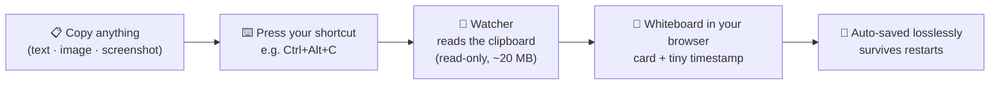

<h1 align="center">G WhiteBoard</h1>

<p align="center">
<em>Copy anything. Press one shortcut. It's on your whiteboard — with a timestamp, saved forever.</em>
</p>

<p align="center">


</p>

---

## What is this? (read this first)

You know how you copy a link, a paragraph, or a screenshot — and then it just
sits in your clipboard until you paste it somewhere and forget it?

**G WhiteBoard turns your clipboard into a scrapbook.**

1. You copy **anything** — a URL, some text, an image, a screenshot — like you normally do.
2. You press **one keyboard shortcut** (default `Ctrl+Alt+C`).
3. That thing appears as a **card on your personal whiteboard** in your browser,
   with a tiny gray timestamp under it, neatly placed on a grid.
4. It is **saved to your own disk forever** — close everything, restart your PC,
   open the board again: everything is still there.
5. Your clipboard is **never touched** — after the capture, `Ctrl+V` still pastes
   into WhatsApp, Word, wherever, exactly as before.

The whiteboard itself is a real whiteboard: pan, zoom, drag cards around,
draw on it, resize things. It runs on your own machine — nothing is sent anywhere
unless *you* decide to share a room (more on that below).

### A 30-second example

> You're researching a trip. You copy a hotel name → `Ctrl+Alt+C`.
> You screenshot a map → `Ctrl+Alt+C`.
> You copy a booking link → `Ctrl+Alt+C`.
>
> Three cards are now sitting on your board, each with the time you grabbed it:
>
> ```
> "Hotel Blue Sky, Kochi"        [a map screenshot]        https://booking.com/xyz
>  2026-11-10 09:14              2026-11-10 09:15          2026-11-10 09:16
> ```
>
> Next morning you open the board — all three are still there, exactly where you left them.

---

## How it works



There are exactly **two parts**:

| Part | What it is | What it does |
|---|---|---|
| **The watcher** | A tiny background program (~20 MB RAM, no Electron) | Listens for your shortcut and reads the clipboard |
| **The board** | A browser tab at `http://localhost:8765` | Shows your whiteboard, auto-saves to disk |

Both start together with one script (below). Leave the browser tab open — that's your board.

---

## Installation

You need two free things installed **once**:

- **Python 3** — [python.org/downloads](https://www.python.org/downloads/)
  (on Windows: tick **"Add Python to PATH"** in the installer's first screen)
- **Node.js** — [nodejs.org](https://nodejs.org) (used once to build the board; any LTS version)

### Windows

Open **PowerShell** (Start → type "powershell") and run these lines one by one:

```powershell
git clone https://github.com/GauthamWho/G-WhiteBoard.git
cd G-WhiteBoard
cd web; npm install; npm run build; cd ..
.venv\Scripts\pip install -r watcher\requirements.txt
.\watcher\start_windows.ps1
```

> No `git` yet? Install it from [git-scm.com](https://git-scm.com), or click
> **Code → Download ZIP** on this page instead and unzip it — then skip the first two lines.

What you'll see: a black window with some text (that's the watcher — minimise it, don't close it),
and a browser tab opening at `http://localhost:8765`. **That tab is your whiteboard.**

### macOS

Open **Terminal** and run:

```bash
git clone https://github.com/GauthamWho/G-WhiteBoard.git
cd G-WhiteBoard
cd web && npm install && npm run build && cd ..
python3 -m pip install -r watcher/requirements.txt
bash watcher/start_mac.command
```

macOS will ask **once** for permission so the shortcut works system-wide:
**System Settings → Privacy & Security → Accessibility →** allow **Python**.
Then open `http://localhost:8765` in your browser — that tab is your whiteboard.

---

## Using it (every day)

### Capturing text or links

1. Copy anything, the normal way (`Ctrl+C` / `Cmd+C`).
2. Press **`Ctrl+Alt+C`** (Mac: the same combo, or whatever you changed it to).
3. Look at your board tab — the capture just appeared, with a timestamp.

### Capturing a screenshot

1. Take a screenshot **to clipboard**:
   - Windows: `Win+Shift+S` (Snipping Tool) or [Flameshot](https://flameshot.org)
   - macOS: `Cmd+Shift+Ctrl+4` (note the `Ctrl` — that copies instead of saving to file)
2. Press **`Ctrl+Alt+C`**.
3. The screenshot lands on the board as an image card, full quality, never re-encoded.

That's the whole learning curve. 🎉

### Things people try (and what happens)

| You do... | What happens |
|---|---|
| Copy something and press the shortcut twice | Only **one** card is created — repeats are de-duplicated |
| Paste right after capturing | Normal paste works — your clipboard was only read, never modified |
| Close the browser tab and reopen it | Everything is still there (it auto-saved) |
| Restart the PC | Everything is still there |
| Draw on the board with the pen tool | Your drawing is saved and captured like everything else |

---

## Changing the shortcut

Open **`watcher/config.json`** in any text editor, change the line, save:

```json
{ "hotkey": "ctrl+alt+c" }
```

Examples: `"ctrl+shift+9"`, `"alt+f2"`, `"f8"`. The change applies **live, within 2 seconds** — no restart.
(A bare letter key like `"c"` is not allowed, so normal typing never triggers a capture.
If another app already owns your combo, a clear message appears in `watcher/watcher.log` — just pick another.)

---

## Where your board lives

Everything is stored on **your own disk**, losslessly (images are never re-encoded or downscaled):

- `watcher/data/board.json` — the full board (this is what the app loads)
- `watcher/data/board.excalidraw` — a portable copy you can open at
  [excalidraw.com](https://excalidraw.com) or any Excalidraw-compatible app

Nothing ever leaves your computer — the board has no internet dependency.

---

## Shared boards: two people, one board, live

You in one place, a friend in another — you can work on the **same whiteboard**,
like Figma or Google Docs do it.

### If your friend is on the same Wi-Fi (same network)

1. Find your computer's local IP (Windows: run `ipconfig`, look for *IPv4 Address*, e.g. `192.168.1.20`).
2. On your board, click **Copy Link** in the room bar, and replace `localhost`
   with your IP: `http://192.168.1.20:8765/?room=trip-planning`
3. Send that link to your friend (their device must be on the same network).
4. Whatever you capture with `Ctrl+Alt+C` appears on their screen within a second — and their edits appear on yours.

### If your friend is far away (different city/state)

Your board runs on your PC, so distant friends need the board **hosted online**.
Deploy it once to a free cloud host — see **[DEPLOY.md](DEPLOY.md)** for the
10-minute setup (free tier, no credit card). After that:

- The board lives at a public link like `https://your-board.onrender.com`
- Anyone you send the room link to (`.../?room=our-board`) sees and edits the same live board
- Your PC can be **off**; your own captures still flow up to the shared board whenever your watcher is running

**How rooms work:** the same room link = the same board. Every change is merged
by element id, so two people never overwrite each other. Everyone who joins gets
the full current board as a snapshot. The room bar (top of the page) shows who's
online — click the small **–** to hide it (a tiny pill remains top-left; click it to bring the bar back).

> 💡 Tip: whoever has the link can edit the board. Share it like a doc link, not a password.

---

## Troubleshooting

| Problem | Fix |
|---|---|
| Pressing the shortcut does nothing | Is the watcher's black window open? Is the board tab open? Check `watcher/watcher.log` — if the combo was already taken by another app, pick a new one (see above) |
| Screenshot lands as text garbage | You saved the screenshot to a file instead of the clipboard — redo the screenshot with the "copy to clipboard" shortcut shown above |
| Board tab shows a blank page | Refresh it. If it keeps happening, check `watcher/watcher.log` for a `CLIENT-ERROR` line and open an issue with it |
| Mac: shortcut does nothing | Give Python Accessibility permission (System Settings → Privacy & Security → Accessibility) |
| Port already in use | Another app owns 8765 — close it, or change `PORT` in `watcher/server.py` |

---

## Building blocks

- [Excalidraw](https://excalidraw.com) — the open-source whiteboard engine
- [aiohttp](https://docs.aiohttp.org) — the tiny Python server
- No Electron. No telemetry. No cloud dependency unless you deploy a room yourself.

## Licence

[Apache License 2.0](LICENSE) — use it, change it, ship it.
