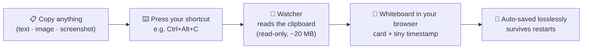

<h1 align="center">G WhiteBoard</h1>
<p align="center"><em>Copy anything anywhere. Press one shortcut. It's on your whiteboard — with a timestamp, saved forever.</em></p>

<p align="center">


</p>

## The idea in one picture



- **Your normal clipboard keeps working** — the shortcut only *reads* it. Ctrl+V still pastes anywhere.
- **Screenshots:** take one with `Win+Shift+S` (or Flameshot, or anything that copies an image), then press the shortcut.
- **A real whiteboard:** pan, zoom, draw, drag, resize — powered by [Excalidraw](https://excalidraw.com), fully offline on your machine.
- **Light as a feather:** no Electron. A tiny background process plus a browser tab.
- **Change the hotkey any time** — it applies live, no restart.

## Quick start (Windows)

Requires [Python 3](https://www.python.org/downloads/) and [Node.js](https://nodejs.org) installed once.

```powershell
git clone https://github.com/GauthamWho/G-WhiteBoard.git
cd G-WhiteBoard
cd web; npm install; npm run build; cd ..
.\watcher\start_windows.ps1
```

A browser tab opens at `http://localhost:8765` — that's your board. Leave it open.

## Quick start (macOS)

Same thing — requires Python 3 and Node.js (`brew install python node`):

```bash
git clone https://github.com/GauthamWho/G-WhiteBoard.git
cd G-WhiteBoard
cd web && npm install && npm run build && cd ..
bash watcher/start_mac.command
```

macOS will ask once for **Accessibility permission** so the global shortcut works
(System Settings → Privacy & Security → Accessibility → allow Python).

## Change the shortcut

Edit `watcher/config.json` (same on both systems) and save — it applies within 2 seconds:

```json
{ "hotkey": "ctrl+alt+c" }
```

Examples: `"ctrl+shift+9"`, `"alt+f2"`, `"f8"` (a bare single key is only allowed for
F-keys, so normal typing never breaks). If the combo is already taken by another app,
a clear error appears in `watcher/watcher.log`.

## Where your board lives

Everything is stored on your own disk, losslessly (images are never re-encoded or
downscaled): `watcher/data/board.json`, plus a portable copy you can open at
excalidraw.com: `watcher/data/board.excalidraw`.

## Shared boards (coming)

Work on the **same board** with someone in another city — a room link, live sync,
the way other whiteboard platforms do it. On the roadmap.

## Licence

[Apache License 2.0](LICENSE) — use it, change it, ship it.
