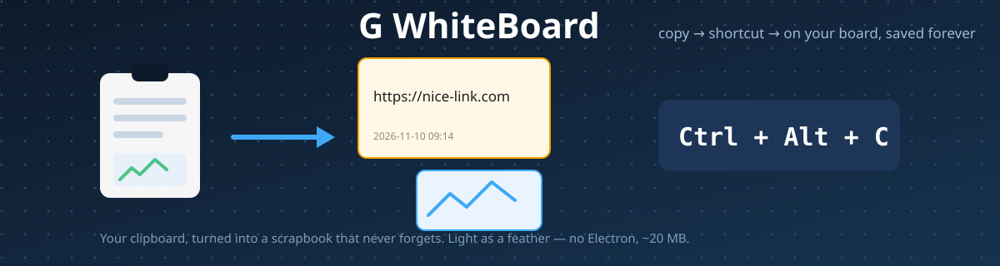
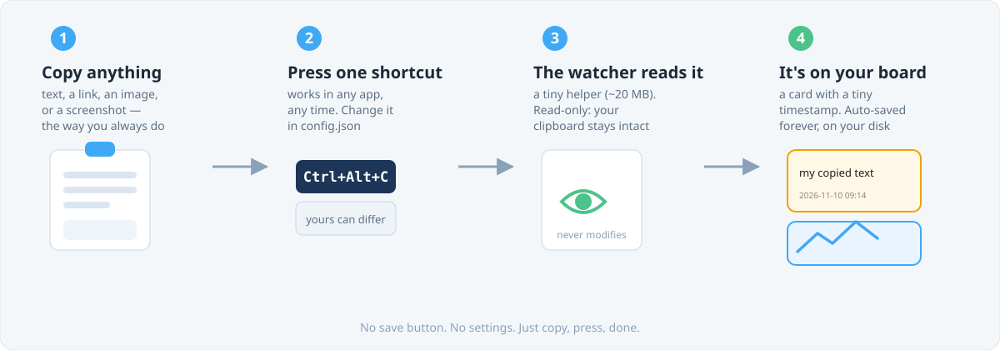
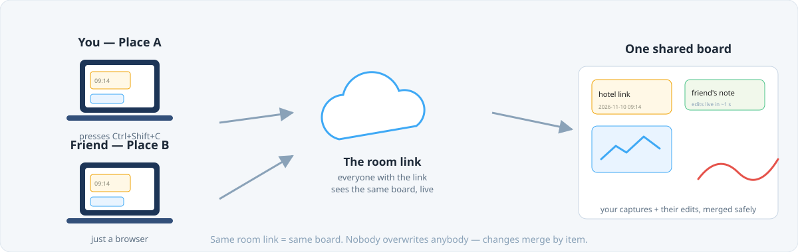

<h1 align="center">G WhiteBoard</h1>

<p align="center">

</p>

**You copy things all day. Links, prices, ideas, screenshots. And then they're gone.**

G WhiteBoard keeps them. You copy something the way you always do, press
**Ctrl + Shift + C** (Mac: **Fn + Cmd + C**), and it appears on your own whiteboard — a neat little card
with the time underneath. Close your laptop, come back tomorrow: everything is
still there.

That's the whole idea. There is nothing else to learn.

<p align="center">

</p>

---

## Start using it (about 5 minutes, once)

You need two free programs first: **[Python](https://www.python.org/downloads)**
(tick "Add Python to PATH" when installing) and **[Node.js](https://nodejs.org)**.

**On Windows** — open PowerShell, paste one line at a time:

```powershell
git clone https://github.com/GauthamWho/G-WhiteBoard.git
cd G-WhiteBoard
cd web; npm install; npm run build; cd ..
.venv\Scripts\pip install -r watcher\requirements.txt
.\watcher\start_windows.ps1
```

**On Mac** — open Terminal, paste:

```bash
git clone https://github.com/GauthamWho/G-WhiteBoard.git
cd G-WhiteBoard
cd web && npm install && npm run build && cd ..
python3 -m pip install -r watcher/requirements.txt
bash watcher/start_mac.command
```

A browser tab opens. **That tab is your board.** A small window also starts in
the background — minimise it and forget it.

> On a Mac, you'll be asked one time to allow "Python" in
> **System Settings → Privacy & Security → Accessibility**. Say yes, so the shortcut works.

---

## Starting it every day (10 seconds)

After the first install, you never type those commands again.

1. Open the **G-WhiteBoard** folder.
2. Double-click **`START G-WhiteBoard (Windows).bat`**
   (Mac: **`START G-WhiteBoard (Mac).command`**).
3. Your board opens in the browser. Minimise the small black window —
   it must stay open while you work (it's the shortcut listener).

**Pro tip:** right-click that file → *Show more options* → *Send to* →
*Desktop (create shortcut)*. Now starting your whiteboard is one click
from your desktop, forever.

**Reopening a closed board tab:** If you close the browser tab, just double-click
**`OPEN G-WhiteBoard (Mac).command`** (Windows: open `http://localhost:8765` in your browser). 
The server stays running — you’re just re-opening the window.

Done? Just copy anything and press `Ctrl+Shift+C` (Mac: `Fn+Cmd+C`) —
it's on your board.

**Screenshots too** — take the screenshot to your clipboard first
(Windows: `Win+Shift+S` · Mac: `Cmd+Shift+Ctrl+4`), then press the shortcut.
They land on the board in full quality.

**Want a different shortcut?** Open `watcher/config.json`, change one line, save.
It applies in 2 seconds. Try `"alt+f2"` or `"f8"`.

---

## Your board is safe

Everything is saved on your own computer, in full quality, automatically —
there is no save button and nothing to remember.

- Restart your PC → board comes back exactly as it was.
- Delete something by mistake? Every day keeps its own backup, and the last
  **7 days** are kept. Nothing is truly lost.
- Nothing ever leaves your computer. No account, no internet needed.

---

## Work on the same board as a friend

You in one place, a friend in another — one board, live, like Google Docs.

<p align="center">

</p>

Just add a room name to your board's address:

```
http://localhost:8765/?room=our-trip
```

Click **Copy Link** at the top and send it to your friend. Whatever you capture
shows up on their screen in about a second, and their edits show up on yours.
Nobody overwrites anybody.

That address only works while your PC is on. To make the board live on the
internet permanently — free, about 10 minutes, once — follow
**[DEPLOY.md](DEPLOY.md)**. Then you get a normal link that works from anywhere.

---

## Something not working?

- **Shortcut does nothing** → is the small background window open? Is the board tab open?
- **Screenshot arrives as weird text** → the screenshot went to a file, not the clipboard. Take it again with the shortcuts above.
- **Board is blank** → refresh the tab once.
- **Mac shortcut silent** → the Accessibility permission (above) wasn't given yet.

Still stuck? [Open an issue](https://github.com/GauthamWho/G-WhiteBoard/issues) — it helps everyone.

---

Made with [Excalidraw](https://excalidraw.com), the open-source whiteboard.
Free to use, change and share — [Apache 2.0 licence](LICENSE).
